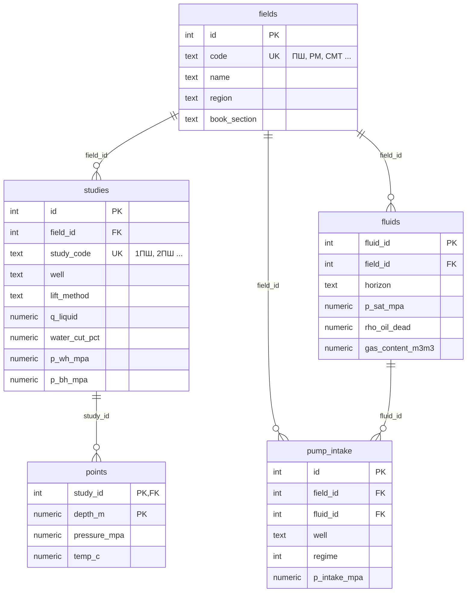

# Dataset of well points

База данных PostgreSQL с результатами промысловых исследований распределения давления и температуры по стволу нефтяных скважин. Данные оцифрованы из справочного пособия Мищенко И.Т., Палий В.О. «Газожидкостные потоки в нефтяных скважинах» (2018) и приведены к единой структуре.

Назначение — тестовый набор для приложений и методик расчёта многофазного потока в скважине: сравнение расчётных кривых P(H) и T(H) с замерами, проверка корреляций, отладка программ.

## Что внутри

| Таблица | Строк | Содержание |
|---|---:|---|
| `fields` | 35 | Месторождения: код, название, регион, раздел книги |
| `fluids` | 6 | PVT-свойства нефти, газа и воды по месторождению/горизонту |
| `studies` | 455 | Исследования: скважина, способ эксплуатации, дебиты, обводненность, конструкция, давления, температуры, газовые факторы |
| `points` | 4 327 | Замеры по глубине: давление и температура |
| `pump_intake` | 107 | Режимы работы ЭЦН/ШСН и замеренное давление на приеме насоса (раздел 2 книги) |

Охват: 35 месторождений (Республика Коми, Татарстан, Башкортостан, Самарская и Волгоградская области, Беларусь, Туркменистан, Западная Сибирь), исследования 1962–1995 гг. Способы эксплуатации: фонтанный, газлифт, ЭЦН, ШСН, ЭВН. Глубины замеров 0–3650 м, давления до 42,1 МПа, температуры 3–131,6 °C.

## Структура репозитория

```
├── data/                        # исходные CSV (UTF-8, разделитель ",")
│   ├── 01_fields.csv
│   ├── 02_fluids.csv
│   ├── 03_studies.csv
│   ├── 04_points.csv
│   └── 05_pump_intake.csv
├── sql/
│   ├── dataset_well_points.sql  # полный дамп БД: схема + данные
│   └── import_log.sql           # журнал создания и загрузки БД (история, не для запуска целиком)
├── docs/
│   └── er_diagram.png           # схема БД из pgAdmin
├── LICENSE
└── README.md
```

## Схема базы данных



Полный список колонок — в `sql/dataset_well_points.sql` и на `docs/er_diagram.png`.

Ключевая связь: одно исследование (`studies`) → много точек замера по глубине (`points`). Первичный ключ `points` — пара (`study_id`, `depth_m`).

## Соглашения

- **Единицы в именах колонок**: `_mpa` — МПа, `_m` — метры, `_c` — °C, `_m3d` — м³/сут, `_m3m3` — м³/м³, `_m3t` — м³/т, `_mpas` — мПа·с, `_pct` — %, `_cms` — см/с, `_deg` — градусы. Плотности (`rho_*`) — кг/м³.
- **Колонки с переменной единицей**: дебиты в книге даны то в т/сут, то в м³/сут — единица хранится рядом (`q_liquid_unit`, `q_oil_unit`, `q_water_unit`); то же для обводненности (`water_cut_type`: массовая/объемная) и газового фактора (`gor_unit`).
- **Пропуски**: если параметр в книге не приведён — `NULL`. Ничего не досчитывалось и не интерполировалось.
- **Давление**: в разделе 1 книги (стр. 14–150) единица давления напечатана как «мПа» — это опечатка, везде имеются в виду **МПа**. В базе все давления в МПа.
- **Примечания** (`note`): диапазоны значений и сведения, которые не уложились в колонки.
- Допустимые значения `lift_method`, `measured_in` и единиц ограничены `CHECK`-ограничениями.

## Известные особенности данных

- **Исследования без точек замера: 3УС, 4УС, 5УС, 6УС, 7УС** (Усинское, пермокарбоновая залежь, УСШН с эксплуатацией по затрубному пространству). В книге для них приведены только параметры скважины, режима и давления (P_пл, P_заб, P_затр), профилей P(H) и T(H) нет. Строки оставлены в `studies` как есть, в `points` записей для них нет.
## Как развернуть

Нужен PostgreSQL 13+ (дамп сделан в 17).

**Через psql:**

```bash
createdb well_points_dataset
psql -d well_points_dataset -f sql/dataset_well_points.sql
```

**Через pgAdmin:** создайте пустую базу → правый клик по ней → *PSQL Tool* → выполните

```
\i 'путь/к/sql/dataset_well_points.sql'
```

> Обычный *Query Tool* дамп не выполнит: данные в нём загружаются командой `COPY ... FROM stdin`, которую понимает только psql.

**Проверка:**

```sql
SELECT 'fields', COUNT(*) FROM fields
UNION ALL SELECT 'fluids', COUNT(*) FROM fluids
UNION ALL SELECT 'studies', COUNT(*) FROM studies
UNION ALL SELECT 'points', COUNT(*) FROM points
UNION ALL SELECT 'pump_intake', COUNT(*) FROM pump_intake;
-- 35 / 6 / 455 / 4327 / 107
```

Если база не нужна — CSV из `data/` открываются в Excel, pandas и т.п. В CSV месторождения и исследования связаны по кодам (`field_code`, `study_code`), а не по числовым id.

## Пример запроса

Кривая давления и температуры для одного исследования:

```sql
SELECT p.depth_m, p.pressure_mpa, p.temp_c
FROM points p
JOIN studies s ON s.id = p.study_id
WHERE s.study_code = '1ПШ'
ORDER BY p.depth_m;
```

## Источник

Мищенко И.Т., Палий В.О. Газожидкостные потоки в нефтяных скважинах: справочное пособие. — М.: РГУ нефти и газа им. И.М. Губкина; Изд-во «ЦентрЛитНефтеГаз», 2018.

Права на исходные данные принадлежат авторам книги. Репозиторий содержит их оцифровку в структурированном виде; ошибки оцифровки возможны — при расхождении приоритет за книгой. Сообщить об ошибке можно через Issues.

## Лицензия

Оцифровка, структура БД и SQL — [CC BY 4.0](https://creativecommons.org/licenses/by/4.0/deed.ru). При использовании ссылайтесь на этот репозиторий и на книгу-источник.

## Автор

Бартенев Владислав Максимович, РГУ нефти и газа (НИУ) имени И.М. Губкина
